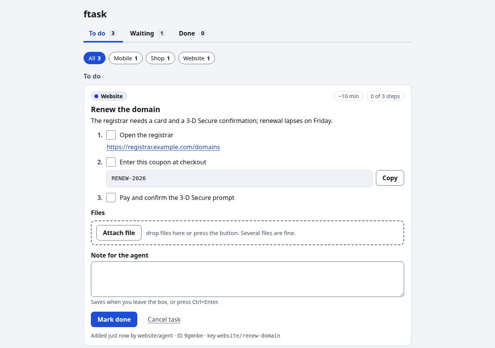

# ftask

**A human-in-the-loop task inbox for AI coding agents** (Claude Code, Codex, Cursor, scripts, anything that can run a shell command).

Agents cannot pay, verify an ID, pass a CAPTCHA or click through a cloud console. When they hit one of those walls they
usually write a paragraph in chat and stall. With ftask the agent instead drops a task in your inbox with the *exact* steps:
the text to paste (with a Copy button), the exact link to open, files to download, files it needs back from you. You tick
through it in a browser; the moment you press **Done**, the agent is woken up and carries on.




```
agent:  ftask add --project Website --title "Renew the domain" --key website/renew-domain \
          --step "Open the registrar" --link https://registrar.example.com/domains \
          --step "Enter this coupon at checkout" --value "RENEW-2026"
agent:  ftask wait website/renew-domain --for done      # runs in the background; exits when you click Done
you:    http://localhost:4747  ->  copy, click, pay, "Mark done"
agent:  wakes up, reads your note, continues
```

Local first: one SQLite file, Python standard library only (no dependencies), no account, no cloud, no telemetry.

## 60-second quickstart

```sh
pipx install ftask            # or: uv tool install ftask
ftask serve --open            # the board, at http://localhost:4747 (leave it running)
ftask snippet >> AGENTS.md    # teach your agent to use it (use CLAUDE.md for Claude Code)
```

Try it without an agent:

```sh
ftask add --project Demo --title "Say hello" --minutes 1 --key demo/hello \
  --step "Copy this" --value "hello from the human" --step "Press Mark done"
ftask wait demo/hello --for done      # blocks here; now click "Mark done" in the browser
```

Requires Python 3.9+ on Linux or macOS. (Windows is not supported yet.)

## What an agent can do

| Need | Command |
| --- | --- |
| Hand over a job with exact values and links | `ftask add --step "..." --value "..." --link URL` |
| Update the same task instead of duplicating it | re-run `ftask add` with the same `--key` |
| Give you a file (invoice, installer, export) | `ftask attach KEY ./file.pdf` (Download button plus the full path to paste into file pickers) |
| Ask you for a file (screen recording, CSV) | `ftask add ... --step "Record it" --upload --accept "video/*"`, then `ftask files KEY --json` |
| Be told when you are done | `ftask wait KEY --for done` as a background command; `--for any` also reports notes, uploads and ticked steps |
| Read your reply | `ftask notes --since 1d`, `ftask show KEY` |
| Mark itself blocked on a third party | `--waiting-on "App store review"` |

Everything is also available as JSON (`--json`) and every command works from a script or cron job.

## Set up your agent

`ftask snippet` prints ready-made instructions (also in [`ftask/AGENTS-SNIPPET.md`](ftask/AGENTS-SNIPPET.md)). Append them to the
`AGENTS.md` (Codex and most other agents) or `CLAUDE.md` (Claude Code) of any project, or to your global
`~/.claude/CLAUDE.md`.

For Claude Code, let it run the CLI without asking each time, in `.claude/settings.json`:

```json
{ "permissions": { "allow": ["Bash(ftask *)"] } }
```

The agent should start `ftask wait` with the Bash tool's `run_in_background` option; Claude Code then notifies the session
when the command exits, which is when you click Done.

## Notifications

* **Agent side**: `ftask wait` (above). Exit code 124 on `--timeout`; it prints a `cursor:` so the next wait misses nothing.
* **Human side**: drop executables in `on-done`, `on-note`, `on-upload` or `on-any` in the hooks directory (below) to get a
  desktop notification, a message to a webhook, anything. A ready example for Linux `notify-send` and macOS is in
  [`docs/hooks/on-any.example`](docs/hooks/on-any.example).

## Keep it running

`ftask serve` is all you need. To start it at login:

```sh
ftask service install --print   # show the systemd user unit (Linux) or launchd agent (macOS); change nothing
ftask service install           # write it and start it
ftask service status
ftask service uninstall
```

## Where things live

| | Linux | macOS |
| --- | --- | --- |
| Database, uploaded and attached files, hook log | `~/.local/share/ftask/` (`$XDG_DATA_HOME`) | `~/Library/Application Support/ftask/` |
| Hooks | `~/.config/ftask/hooks/` (`$XDG_CONFIG_HOME`) | `~/Library/Application Support/ftask/hooks/` |

`FTASK_DB=/path/tasks.db` (or `--db`) points anywhere else. `ftask path` prints the database path; `ftask backup DEST` takes a
consistent copy.

## Security

There is no login, so the board binds `127.0.0.1` only and refuses foreign `Host` headers (DNS rebinding), cross-origin or
token-less writes, and path traversal in uploads. Do not put it on a network. Tasks can only be created through the CLI, never
over HTTP. `--notify-cmd` and hooks run shell commands as your user, so only your own agents should set them. Details in
[docs/REFERENCE.md](docs/REFERENCE.md#web-ui).

## More

* [docs/REFERENCE.md](docs/REFERENCE.md): every command, the data model, files, hooks, the JSON API, backup.
* `ftask --help`, `ftask <command> --help`: examples for each command.
* Tests: `python3 -m unittest discover -s tests` (about a minute; uses temporary databases only).

## How it compares

ftask is a *task list for a human*, not an approval gate. If you only want "allow / deny this tool call" on your phone, Claude
Code's own notification hooks, ntfy-based approvers or a phone app will do that with less setup. ftask is for the jobs that take
several steps outside the terminal, with values to paste and files going each way, where the agent needs to know when you
finished. It has no phone push yet.

## Licence

MIT. Copyright TurboKast Ltd.
